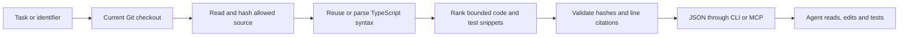

# How Wraith Context works, and whether it helps

October 16, 2026. Implementation review and an offline audit of the completed
agent comparison. No new model calls, experiments or product claims were added.

Wraith Context is a Node.js program with a terminal interface and a stdio MCP
server. Both call the same local retrieval engine. It packages source code for a
coding agent; the agent still reasons about the change, edits files and runs tests.



## Retrieval pipeline

1. **Select the checkout.** The server binds to one Git root when it starts. It
   records separate hashes for the shared Git repository and checkout location.
   HEAD and source-content hashes identify the observed state, including dirty files.

2. **Read allowed source.** Git supplies tracked and nonignored untracked paths.
   The scanner filters supported JS/TS extensions, hidden paths, common private
   filenames, dependencies, generated output, symlinks and nested repositories.
   It hashes source and checks inventory/HEAD/content again to detect changes.
   Limits are 20,000 files, 2 MiB per file and 128 MiB total. Indexing does not
   execute the target application's scripts.

3. **Parse or reuse syntax.** The TypeScript parser creates an abstract syntax
   tree: a structured representation of declarations and expressions. Wraith
   extracts named definitions, identifier occurrences and import declarations
   with source offsets. Syntax objects are cached by content hash, parser version,
   file extension and cache schema. Unchanged source can reuse parsing across
   worktrees. Every query still reads/hashes files; this is not a watcher or
   an incremental filesystem index. Syntax errors are reported, not type-checked.

4. **Rank candidates.** Task words retain whole identifiers and camel/snake-case
   pieces, with simple suffix normalization. A word found in fewer source files
   gets more weight. Short named definitions and overlapping 32-line windows
   are scored using word matches, path matches and enclosing syntax names.
   Exact identifier matches receive a bonus. Length normalization and overlap
   suppression reduce some irrelevant/repeated snippets. Candidate test snippets
   get reserved positions where the result/byte budget permits.

5. **Bound and validate the response.** A result contains relative paths, line
   ranges, snippet text and SHA-256 source hashes. Cited files and HEAD are checked
   again before return. The default is eight results and 12,000 UTF-8 snippet
   bytes; the agent study requested 16,000. Metadata is outside that byte budget.
   Missing/omitted/truncated context is explicit. These checks do not create an
   atomic filesystem snapshot or prove that the snippets are relevant.

6. **Expose tools.** `code_context` ranks task snippets, `code_symbols` finds named
   syntax definitions, and `code_references` returns lexical identifier occurrences.
   The official MCP SDK carries JSON over stdin/stdout. There is no HTTP service,
   embedding model, GPU, hosted database or model call in the retrieval engine.

The implementation is in [repository scanning](../experiments/code-context/lib/repository.cjs),
[syntax/cache/ranking](../experiments/code-context/lib/index.cjs) and
[CLI/MCP transport](../experiments/code-context/cli.cjs).

This is syntax-assisted lexical search. It does not establish a complete semantic
call graph, resolve arbitrary aliases or prove affected-test coverage. Local
privacy also depends on the calling agent: it may send returned source to a
remote model provider.

## A concrete result

The prepared four-file demo queried:

> Find canAccessProject, its API caller and tests for an expired trial.

Its recorded result contained 2,151 snippet bytes with these citations:

| Source | Lines | Role |
| --- | --- | --- |
| `src/auth/permissions.ts` | 3–12 | Access decision |
| `src/api/projects.ts` | 4–12 | API caller |
| `src/billing/subscriptions.ts` | 1–6, 8–11 | Subscription type and eligibility rule |
| `tests/access.test.mjs` | 1–19 | Trial, cancellation and authorization boundaries |

The agent can read those pieces together instead of locating each separately.
This demonstrates mechanics on a deliberately prepared application, not general
retrieval quality or an independently observed saving.

## Assessment of actual agent traces

The existing study used the same model snapshot and native tools on three
historical production fixes, with one observation per approach/task. Both lanes
received approved source/test paths and thirty-request limits. One lane also
received a task-only context bundle automatically before its first request.
Both approaches passed the unchanged selected upstream test files.

The new [offline trace audit](../experiments/code-context/study/trace-assessment.json)
revalidates the saved results, request artifacts, delivered bundles and frozen
candidate hashes. It does not run or replay an agent.

| Task | Navigation calls: native / context | Model requests: native / context |
| --- | --- | --- |
| Hono precompressed responses | 6 / 2 | 11 / 8 |
| Zod memoizer retention | 5 / 3 | 9 / 6 |
| tRPC lazy-router boundary | 5 / 1 | 8 / 5 |
| Total | **16 / 6** | **28 / 19** |

Navigation counts include file listings, literal searches and source reads. Initial
retrieval is additional work, not a free eliminated operation. Context runs made
seven edit calls versus six for native search. In tRPC, the supplied bundle
contained the exact line replaced by the first edit. The agent then made one
targeted read before editing; native search made five navigation calls. This is
consistent with less navigation, but exact-text availability cannot prove model
attention or a causal effect.

Total estimated provider cost was 14.7% lower, while median cost was only 0.33%
lower. Two tasks took longer with context, including retrieval and final tests.
There was no observed correctness improvement: both passed three selected files.
These are small historical observations, not a reliable future savings estimate.
See [complete results, costs and limits](code-context-followup.md).

The shipped preview makes MCP tools optional. The original optional-tool study
never invoked `code_context`. Automatic initial delivery and voluntary MCP use
are different integrations; the successful delivery result does not prove that
simply configuring the preview will deliver the same benefit.

## What is established

The tool can return current, cited code and can replace some navigation calls in
the recorded tasks when supplied automatically. It has not established a broad
quality, cost or latency improvement for coding agents. Its uncommon-term scoring,
partial import resolution and repeated filesystem scans remain practical limits.

In this review, all fifteen prototype/preview tests and ten study-boundary tests
passed again on macOS arm64 with Node.js 22.19.0 and Python 3.13.0. They exercise
dirty edits, branch switches, conflicting worktrees, corrupt caches, stale citations,
limits, exclusions, MCP, install/demo/uninstall and budget/experiment boundaries.
Passing component tests establish implementation behavior, not agent benefit.

Broader technical evidence would require frozen unfamiliar tasks, repeated model
observations, randomized order, stronger patch validation and an actual proposed
integration compared with native search and a capable existing context tool.
Count initial context cost, setup failures and incomplete runs. A context-removal
control could help isolate its contribution; it cannot reveal internal attention.
Such a new paid study would require separate authorization and budget. No further
experiment is scheduled here. Independent repeat use and paid demand remain the
separate [preview decision](code-context-preview.md).

To reproduce only this offline audit from retained local evidence:

```sh
python3 experiments/code-context/scripts/assess-traces.py \
  --evidence .wraith/code-context-study/context-followup-2026-10-16 \
  --output .wraith/code-context-preview/new-trace-assessment.json
```

The controller refuses to overwrite the output. It verifies the original result
hashes and public aggregate; changing old evidence causes an error rather than a
new success. Raw traces remain local. The public audit contains counts/hashes,
no machine paths, credentials or model conversation text.
